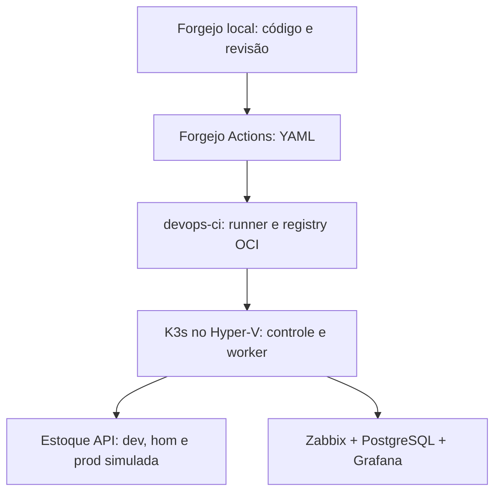

# Plataforma DevOps no Hyper-V: cenário de SaaS de estoque

## Contexto

Este é um cenário fictício de cliente: uma equipe desenvolve um SaaS de controle de estoque e precisa publicar mudanças com teste, aprovação, observabilidade e possibilidade de reversão. A infraestrutura é um **homelab próprio**, com ambientes de desenvolvimento, homologação e produção *simulada*. Esses nomes representam fluxos de entrega separados, não uma produção comercial nem alta disponibilidade. O objetivo é executar, medir e documentar cada parte antes de apresentá-la como concluída.

O laboratório parte de um host Windows 11 Pro/Hyper-V com cerca de 32 GiB de RAM. Já existem `lab-ops` (Debian, 5 GiB) e `lab-storage` (Debian, 3 GiB), além dos switches `Default Switch` e `LAB-MGMT`. O inventário atual do host deve ser confirmado antes de criar novas VMs. O trabalho de backup/storage existente permanece isolado.

## Arquitetura proposta



Todo o plano de controle de CI/CD ficará no homelab: Forgejo com repositório e Forgejo Actions, runner próprio e registry OCI do Forgejo. O GitHub é apenas a vitrine pública do código e das evidências revisadas, sincronizada depois. Internet pode ser usada para baixar imagens e dependências, mas nenhum serviço Azure participa da execução. O arquivo `azure-pipelines.yml` preexistente no repositório é um **exemplo preparado, não executado** neste cenário. K3s e o registry local permitem demonstrar o fluxo de Kubernetes e imagens, sem alegar uso de AKS/ACR. O runner terá credenciais de deploy restritas e tráfego local de gestão pela `LAB-MGMT`.

### Capacidade inicial, sujeita ao preflight

| VM | CPU | RAM fixa | VHDX dinâmico | Rede |
| --- | ---: | ---: | ---: | --- |
| `devops-ci` | 2 | 4 GiB | 50 GiB | Default Switch e LAB-MGMT; Forgejo, runner e registry |
| `devops-k3s-cp` | 2 | 4 GiB | 40 GiB | Default Switch e LAB-MGMT |
| `devops-k3s-worker` | 2 | 7 GiB | 70 GiB | Default Switch e LAB-MGMT |

As novas VMs somam 15 GiB. Com as VMs de backup ligadas, o total configurado dos dois projetos pode chegar a 23 GiB, antes do Windows e de serviços do host. Não há pressuposto de que tudo rodará simultaneamente; a capacidade será ajustada com base em RAM livre, consumo real, CPU e I/O antes do provisionamento. Um controle e um worker no mesmo host físico não oferecem HA real.

| Volume | Uso previsto |
| --- | --- |
| `L:` (`LAB_VMS`) | Configuração das VMs em `L:\HyperV\VMs`, discos de sistema em `L:\HyperV\VHDX` |
| `M:` (`LAB_LUN`) | Reservado ao laboratório de storage existente; sem novos discos do SaaS |
| `N:` (`LAB_BKP`) | Exportações e cópias de dados do novo projeto em pasta própria, após definir retenção |
| `C:` e `E:` | Fora do provisionamento de VMs deste cenário |

## Entregas e critérios de aceite

1. **Inventário:** executar `infra/hyperv/Get-StockSaasPreflight.ps1`; conferir rótulos, caminhos, switches, VMs e margem de RAM. Não criar VMs se faltar margem ou houver nomes em uso.
2. **Infraestrutura reproduzível:** provisionamento por PowerShell idempotente, sem limpeza de disco; Linux por Ansible e acesso por SSH. Validar cada etapa antes de prosseguir.
3. **Aplicação:** API Node.js/TypeScript de estoque, com um cliente fictício e dados de demonstração; testes unitários, integração e rota de saúde. A aplicação terá armazenamento persistente e migrações versionadas.
4. **CI/CD:** subir Forgejo e runner locais, executar workflow YAML em Forgejo Actions. Revisão por PR, build, testes, imagem tagueada pelo SHA do commit, scanner, publicação no registry OCI local e deploy por Helm. PRs não recebem segredos de deploy. Publicar no GitHub apenas código e documentação revisados; o fluxo local continua independente.
5. **Ambientes:** namespaces `estoque-dev`, `estoque-hom` e `estoque-prod-simulada`; aprovação humana antes da última promoção, smoke test e rollback exercitado. Dados de teste e credenciais separados por namespace.
6. **Monitoramento:** Zabbix Server, interface web e PostgreSQL **no cluster**, com volumes persistentes e limites de recursos; agentes/proxy do chart oficial para o cluster, conforme necessidade. Grafana **no cluster** com plugin de fonte de dados Zabbix. Monitorar saúde da API, disponibilidade, pods/nós e capacidade; provocar alerta e verificar recuperação. A instalação do chart oficial de integração não será confundida com a instalação do servidor Zabbix.
7. **Recuperação:** testar backup e restore do banco do SaaS e da configuração declarativa, em destino segregado em `N:`; documentar perda aceitável, duração medida e limites do teste. Snapshot de VM não substitui backup consistente do banco.
8. **Documentação:** arquitetura, ADRs, runbooks, resultados observados, capturas sem segredos, caminho de reprodução e roteiro de demonstração. Marcar como pendente tudo que não tiver comando, saída e data de validação.

## Primeira execução: somente leitura

No PowerShell do **host Windows**, sem depender da instalação do Git:

```powershell
$destino = 'E:\Projetos\Get-StockSaasPreflight.ps1'
$url = 'https://raw.githubusercontent.com/Glaucojr17/devops-platform-lab/main/infra/hyperv/Get-StockSaasPreflight.ps1'
Invoke-WebRequest -Uri $url -OutFile $destino -UseBasicParsing -ErrorAction Stop
Unblock-File -LiteralPath $destino
& $destino | ConvertTo-Json -Depth 8
```

Se o script já estiver disponível no clone do repositório, também pode ser executado por:

```powershell
$script = '.\infra\hyperv\Get-StockSaasPreflight.ps1'
& $script | Format-List
```

Para compartilhar uma saída estruturada com o projeto, grave-a apenas em diretório local de trabalho e revise-a antes de publicar:

```powershell
& $script | ConvertTo-Json -Depth 8 | Set-Content -LiteralPath "$env:USERPROFILE\Documents\stock-saas-preflight.json" -Encoding UTF8
```

O script não cria VMs, não modifica discos e interrompe a leitura com erro se um comando essencial falhar. A verificação de RAM usa 15 GiB para as novas VMs e sugere preservar mais 6 GiB para o host; é um **critério inicial**, não uma garantia de capacidade. O relatório contém nomes, caminhos e informações do host: revise-o antes de anexá-lo a um repositório público.

## Estado registrado

**Planejamento e preflight preparados.** Git ainda não está instalado no host Windows, então o inventário será baixado diretamente. Até o momento, nenhuma VM nova, instalação K3s, Forgejo/runner ou implantação Zabbix/Grafana deste cenário foi validada no host. O próximo marco depende da saída do preflight no Windows.
