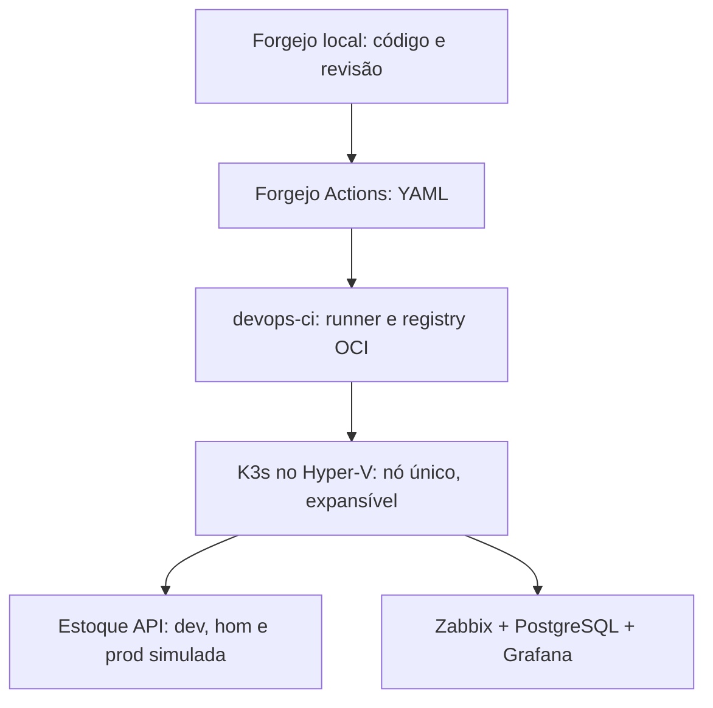

# Plataforma DevOps no Hyper-V: cenário de SaaS de estoque

## Contexto

Este é um cenário fictício de cliente: uma equipe desenvolve um SaaS de controle de estoque e precisa publicar mudanças com teste, aprovação, observabilidade e possibilidade de reversão. A infraestrutura é um **homelab próprio**, com ambientes de desenvolvimento, homologação e produção *simulada*. Esses nomes representam fluxos de entrega separados, não uma produção comercial nem alta disponibilidade. O objetivo é executar, medir e documentar cada parte antes de apresentá-la como concluída.

O laboratório parte de um host Windows 11 Pro/Hyper-V com 31,9 GiB de RAM. Em 01/11/2026 às 15:11 (-03), havia 16,3 GiB livres e as VMs `lab-ops` (5 GiB) e `lab-storage` (3 GiB) estavam desligadas. Volumes L/M/N, caminhos do Hyper-V e switches base passaram no inventário. O plano antigo de três VMs/15 GiB não passou na reserva de 6 GiB para o Windows; este plano usa inicialmente **duas VMs/10 GiB**. O trabalho de backup/storage existente permanece isolado.

## Arquitetura proposta



Todo o plano de controle de CI/CD ficará no homelab: Forgejo com repositório e Forgejo Actions, runner próprio e registry OCI do Forgejo. O GitHub é apenas a vitrine pública do código e das evidências revisadas, sincronizada depois. Internet pode ser usada para baixar imagens e dependências, mas nenhum serviço Azure participa da execução. O arquivo `azure-pipelines.yml` preexistente no repositório é um **exemplo preparado, não executado** neste cenário. K3s e o registry local permitem demonstrar o fluxo de Kubernetes e imagens, sem alegar uso de AKS/ACR. O runner terá credenciais de deploy restritas e tráfego local de gestão pela `LAB-MGMT`.

### Capacidade inicial, sujeita ao preflight

| VM | CPU | RAM fixa | VHDX dinâmico | Rede |
| --- | ---: | ---: | ---: | --- |
| `devops-ci` | 2 | 4 GiB | 50 GiB | Default Switch e LAB-MGMT; Forgejo, runner e registry |
| `devops-k3s` | 4 | 6 GiB | 100 GiB | Default Switch e LAB-MGMT; controle e workloads |

As novas VMs somam 10 GiB; se as duas VMs antigas também forem ligadas, o total configurado será 18 GiB, sem contar Windows e serviços do host. Não iniciar os dois laboratórios simultaneamente sem novo inventário. No instante medido, ligar apenas as duas VMs novas deixaria 6,3 GiB livres ao Windows; isso precisa ser medido novamente antes do boot e durante as cargas de build e Zabbix. K3s em nó único é funcional para workloads, mas não fornece HA. Adicionar worker somente após confirmar RAM e I/O suficientes. A VM `devops-k3s` deve ter limites de recursos e armazenamento persistente dimensionado para Zabbix, PostgreSQL, Grafana e a aplicação.

| Volume | Uso previsto |
| --- | --- |
| `L:` (`LAB_VMS`) | Configuração das VMs em `L:\HyperV\VMs`, discos de sistema em `L:\HyperV\VHDX` |
| `M:` (`LAB_LUN`) | Reservado ao laboratório de storage existente; sem novos discos do SaaS |
| `N:` (`LAB_BKP`) | Exportações e cópias de dados do novo projeto em pasta própria, após definir retenção |
| `C:` e `E:` | Fora do provisionamento de VMs deste cenário |

## Entregas e critérios de aceite

1. **Inventário:** executado em 01/11/2026; rótulos, caminhos e switches conformes. Revalidar RAM imediatamente antes de iniciar as duas VMs e observar o consumo sob carga.
2. **Infraestrutura reproduzível:** provisionamento por PowerShell com preflight e modo explícito `-Apply`, sem limpeza de disco; Linux por Ansible e acesso por SSH. Validar cada etapa antes de prosseguir.
3. **Aplicação:** API Node.js/TypeScript de estoque, com um cliente fictício e dados de demonstração; testes unitários, integração e rota de saúde. A aplicação terá armazenamento persistente e migrações versionadas.
4. **CI/CD:** subir Forgejo e runner locais, executar workflow YAML em Forgejo Actions. Revisão por PR, build, testes, imagem tagueada pelo SHA do commit, scanner, publicação no registry OCI local e deploy por Helm. PRs não recebem segredos de deploy. Publicar no GitHub apenas código e documentação revisados; o fluxo local continua independente.
5. **Ambientes:** namespaces `estoque-dev`, `estoque-hom` e `estoque-prod-simulada`; aprovação humana antes da última promoção, smoke test e rollback exercitado. Dados de teste e credenciais separados por namespace.
6. **Monitoramento:** Zabbix Server, interface web e PostgreSQL **no cluster**, com volumes persistentes e limites de recursos; agentes/proxy do chart oficial para o cluster, conforme necessidade. Grafana **no cluster** com plugin de fonte de dados Zabbix. Monitorar saúde da API, disponibilidade, pods/nós e capacidade; provocar alerta e verificar recuperação. A instalação do chart oficial de integração não será confundida com a instalação do servidor Zabbix.
7. **Recuperação:** testar backup e restore do banco do SaaS e da configuração declarativa, em destino segregado em `N:`; documentar perda aceitável, duração medida e limites do teste. Snapshot de VM não substitui backup consistente do banco.
8. **Documentação:** arquitetura, ADRs, runbooks, resultados observados, capturas sem segredos, caminho de reprodução e roteiro de demonstração. Marcar como pendente tudo que não tiver comando, saída e data de validação.

## Primeira execução: somente leitura

No PowerShell do **host Windows**, sem depender da instalação do Git. Se você já tem o arquivo antigo, baixe-o novamente para obter o plano de duas VMs:

```powershell
$destino = 'E:\Projetos\Get-StockSaasPreflight.ps1'
$url = 'https://raw.githubusercontent.com/Glaucojr17/devops-platform-lab/main/infra/hyperv/Get-StockSaasPreflight.ps1'
Invoke-WebRequest -Uri $url -OutFile $destino -UseBasicParsing -ErrorAction Stop
Unblock-File -LiteralPath $destino
& $destino | ConvertTo-Json -Depth 8
```

Se o script já estiver disponível no clone do repositório, também pode ser executado por:

```powershell
$script = '.\infra\hyperv\Get-StockSaasPreflight.ps1'
& $script | Format-List
```

Para compartilhar uma saída estruturada com o projeto, grave-a apenas em diretório local de trabalho e revise-a antes de publicar:

```powershell
& $script | ConvertTo-Json -Depth 8 | Set-Content -LiteralPath "$env:USERPROFILE\Documents\stock-saas-preflight.json" -Encoding UTF8
```

O script não cria VMs, não modifica discos e interrompe a leitura com erro se um comando essencial falhar. A verificação de RAM usa 10 GiB para as novas VMs e sugere preservar mais 6 GiB para o host; é um **critério inicial**, não uma garantia de capacidade. O relatório contém nomes, caminhos e informações do host: revise-o antes de anexá-lo a um repositório público.

## Próxima etapa: criar as VMs desligadas

O script `infra/hyperv/New-StockSaasBaseVMs.ps1` usa a ISO Debian previamente validada em `L:\HyperV\ISO\debian-13.7.0-amd64-netinst.iso`. Sem `-Apply`, só verifica memória, volumes, switches, caminhos, ISO e colisões. Com `-Apply`, confere também o hash da ISO e cria **somente** `devops-ci` e `devops-k3s`, ambas desligadas. Em falha parcial, interrompe e preserva os objetos para inspeção manual; não tente repetir cegamente.

Antes de executá-lo, confirme que o preflight de 10 GiB passa e que `lab-ops` e `lab-storage` permanecerão desligadas durante a instalação e os primeiros testes. A criação das VMs não inicia nem instala Debian automaticamente. Após conferir as VMs criadas, o próximo passo é instalar o SO no `devops-ci` e no `devops-k3s`, um de cada vez, para registrar os MACs e configurar a rede de gestão sem gateway; a saída de Internet usa DHCP do Default Switch.

## Estado registrado

**Resultado em 01/11/2026:** preflight atualizado passou com 17,3 GiB livres; `-Apply` passou com 17,1 GiB livres e criou `devops-ci` (4 GiB, 50 GiB VHDX) e `devops-k3s` (6 GiB, 100 GiB VHDX), ambas **Off**. O `Path` de configuração resultou em `L:\HyperV\VMs\devops-ci\devops-ci` e `L:\HyperV\VMs\devops-k3s\devops-k3s`; não altera o local dos VHDXs e será mantido nas VMs já criadas. O script foi corrigido para apontar ao diretório base em instalações futuras, sem movimentar as VMs existentes. Nenhum Debian novo, K3s, Forgejo/runner ou Zabbix/Grafana foi validado ainda. Próximo marco: instalar Linux, começando por `devops-ci`.

Veja o [guia da primeira instalação](02-debian-ci.md) e a [configuração da rede de gestão](03-rede-ci.md).

**Debian da `devops-ci` validado em 02/11/2026:** hostname correto, Debian 13, disco virtual de 50 GiB, SSH ativo e saída DHCP pela `eth0`. A rede `MGMT` ainda será identificada por MAC e configurada sem gateway. `devops-k3s` permanece desligada; K3s, Forgejo e monitoramento ainda não foram instalados.
